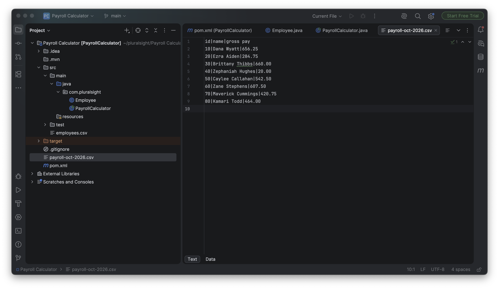

# Hey, I'm Ezana 👋

**Year Up United student** | Future economics major | Aspiring developer at a finance company 📈

[About me](#about-me) · [My toolbox](#my-toolbox) · [What I am building](#what-i-am-building) · [My next steps](#my-next-steps) · [Beyond the keyboard](#beyond-the-keyboard)

---

## About me

Thanks for stopping by!

I've always been curious about money: how markets move, why prices go up and down, and how people make smart financial decisions. That curiosity is what got me into coding. I wanted to build my own tools instead of just using other people's.

Right now I'm at **Year Up United**, learning Java. Some days my code works on the first try. *Most* days it doesn't. But ~~I give up~~ I figure it out, and that feeling when it finally runs is the best part. :muscle:

What I care about:

- Finance and economics
  - Trading
  - Understanding how markets move
- Building things that actually help people
- Getting a little better every day

## My toolbox

| Language / Tool | How I use it | Where I'm at |
| :--- | :--- | :---: |
| Java | My Year Up United projects | Learning every day 🌱 |
| Python | My trading and finance tools | Comfortable |
| SQL | Working with data | The basics |
| C++ | Practice | A little |
| C# | Practice | A little |
| Git & GitHub | Saving and sharing my work | Getting there |

### What I'm learning right now

1. HashMaps and ArrayLists in Java
2. Reading and writing files
3. Using Git without panicking

## What I am building

**My trading tool.** I built my own tool to help with trading. It's the project that made me realize I actually love building things with code.

**Payroll Calculator (Java).** It reads a list of employees from a file, figures out how much each person earns, and saves everything to a new file. Simple, but it was a big moment when it worked.



Here's a small piece of code I'm proud of, from my store inventory app:

```java
Product matchedProduct = inventory.get(id);
if (matchedProduct == null) {
    System.out.println("We don't carry that product");
}
```

[Check out my repositories](https://github.com/ezanaGa99-sketch?tab=repositories) · [Java docs I keep open all the time](https://docs.oracle.com/en/java/javase/17/docs/api/java.base/java/lang/String.html)

> [!TIP]
> My repositories show what I'm learning week by week, mistakes included.

## My next steps

- [x] Build my own trading tool
- [x] Make my GitHub profile
- [ ] Finish the Year Up United program
- [ ] Get my bachelor's degree in economics
- [ ] Work as a developer at a finance company

---

## Beyond the keyboard

> One step at a time. — Ezana

When I'm not coding, I'm usually reading about **economics** or watching the markets. I like knowing *why* things happen, not just *what* happened.[^markets]

<details>
<summary>Fun fact about me</summary>

I know a little bit of five programming languages, and I still forget semicolons in Java.

</details>

[^markets]: I'm still learning, but every day it makes a little more sense.
